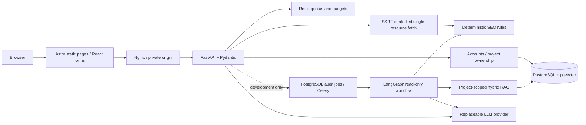
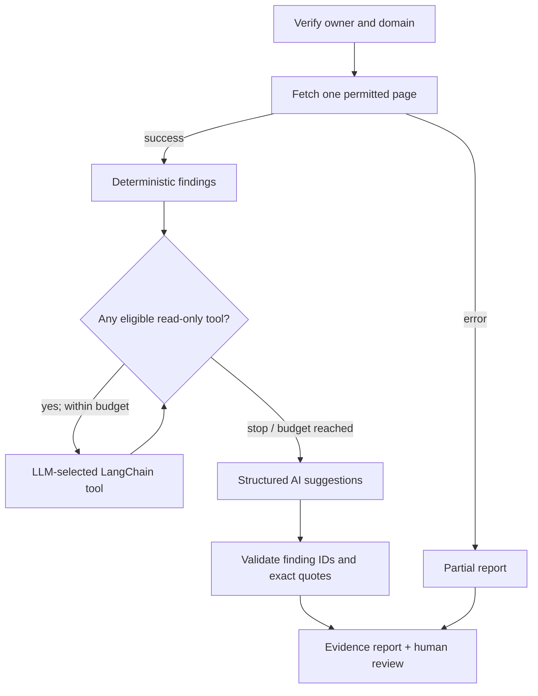

# AISEOOnline

**Evidence-first SEO tools, bounded AI engineering, and reproducible evaluation.**

[Website](https://aiseoonline.com) · [Public tools](https://aiseoonline.com/tools/) · [Recorded benchmark](https://aiseoonline.com/open-source/benchmarks/) · [Architecture](docs/architecture.md) · [Local setup](docs/getting-started.md) · [Release readiness](docs/release-readiness.md)

**Project status: pre-release source implementation; not certified for production use.** The public website has not been verified as running this GitHub revision. Nine deterministic checkers and one optional, credential-dependent AI metadata generator are implemented in source and covered by CI. Private LangGraph audits, RAG chat, durable workers and report exports are **real development/test implementations**, deliberately **not available through production API routes**. The single-page agent does not provide an unrestricted multi-page audit.

## Try the tools

The nine deterministic public checkers require **no signup**; they use bounded URL fetching and Redis admission controls. Availability on any deployed site depends on the operator's backend and Redis configuration.

| Public page | What it checks |
| --- | --- |
| [Robots.txt validator](https://aiseoonline.com/tools/robots-txt-validator/) | Robots groups, syntax and crawl instructions |
| [XML sitemap validator](https://aiseoonline.com/tools/xml-sitemap-validator/) | Sitemap XML structure and declared URLs |
| [Meta tag checker](https://aiseoonline.com/tools/meta-tag-checker/) | Title, description and robots metadata |
| [Redirect chain checker](https://aiseoonline.com/tools/redirect-chain-checker/) | Status codes, hops, loops and destinations |
| [Canonical URL checker](https://aiseoonline.com/tools/canonical-url-checker/) | Canonical hints and conflicts |
| [Structured data checker](https://aiseoonline.com/tools/structured-data-checker/) | JSON-LD syntax and structure; **not** rich-result eligibility |
| [Heading structure analyzer](https://aiseoonline.com/tools/heading-structure-analyzer/) | Visible H1–H6 outline and ordering |
| [Internal link checker](https://aiseoonline.com/tools/internal-link-checker/) | Extracted links and a **bounded** subset of internal destination checks |
| [Social metadata checker](https://aiseoonline.com/tools/social-metadata-checker/) | Open Graph/X fields and **approximate**, not platform-exact previews |
| [AI title and meta generator](https://aiseoonline.com/tools/ai-meta-suggestions/) | Three editable source-grounded drafts; requires model credentials, known pricing, Redis quotas and a cost budget |

Deterministic technical findings are distinct from generated suggestions. No checker guarantees crawling, indexing, ranking, traffic, rich results or revenue. The site includes independent instructions, examples, troubleshooting, limitations and linked guides.

## System design



The dotted workflow is **not enabled in production**. Only authorized development projects may run private audits and RAG tests. The crawler limits DNS/IP/redirect destinations, bodies, runtime and concurrency; production still requires independent network-level egress controls. The full [trust-boundary and threat model](docs/security-threat-model.md) distinguishes implemented checks from unconfigured infrastructure.



The graph uses actual LangGraph `StateGraph` conditional edges and LangChain `StructuredTool` adapters. Evidence quote checks are **not semantic entailment**: a known contradictory claim can pass the present RAG safeguard. No automatic website changes occur.

## Technology and engineering choices

| Layer | Implemented approach | Why |
| --- | --- | --- |
| Web | Astro, React, TypeScript, Tailwind, static Nginx | Fast content pages with interactive forms only where useful |
| API | FastAPI, Pydantic, Python 3.12 | Typed validation and explicit error contracts |
| Data | PostgreSQL, pgvector, SQLAlchemy, Alembic | Relational ownership, vector and full-text retrieval |
| Work | Redis, Celery, LangGraph checkpoint persistence | Bounded quotas and recoverable development jobs |
| AI | Replaceable model provider, LangChain/LangGraph | Testable structured outputs and read-only tool orchestration |
| Retrieval | Verified-owner project scoping, keyword/vector fusion, citations | Source-linked answers without cross-project search |
| Quality | Pytest, Ruff, mypy, Playwright, axe, GitHub Actions | Reproducible regression and browser checks |
| Operations | Docker Compose, opt-in OTLP/Langfuse, Cloudflare tunnel plan | Isolated origin and observable, explicitly gated operations |

See [architectural decisions](docs/adr/README.md), [retrieval design](docs/rag-retrieval.md), [audit design](docs/langgraph-audit.md), [observability](docs/ai-observability.md) and [deployment](docs/deployment.md).

## Run it locally

Prerequisites: Docker Compose v2, sufficient disk/memory, and a shell. Copy `.env.example` to `.env`; set **new, independent random hexadecimal** `AISEO_DB_PASSWORD` and `AISEO_REDIS_PASSWORD` values. Do not commit `.env`.

```bash
cp .env.example .env
# Edit .env: set both passwords (example generation: openssl rand -hex 24)
docker compose up --build -d
docker compose ps
curl -fsS http://127.0.0.1:4321/api/v1/ready
```

Open **http://127.0.0.1:4321/**. Docker Compose starts PostgreSQL/Redis, runs Alembic migrations, then the API, worker and static web container. The AI generator will clearly report unavailable service without an approved provider key and rates. The separate [developer setup](docs/getting-started.md) covers Node.js 22+, pnpm 10, uv and Python 3.12.

```bash
# From the repository root after installing locked dependencies:
uv sync --project apps/api --locked --group dev
uv run --project apps/api --locked pytest apps/api/tests -q
uv run --project apps/api --locked python -m aiseoonline_api.evaluation --output /tmp/seo-eval.json
pnpm install --frozen-lockfile
pnpm lint:web && pnpm check:web && pnpm build:web
pnpm e2e:web
```

The browser command requires Playwright Chromium. PostgreSQL/worker integration tests need the isolated services configured by CI. The [quality report](docs/quality-review.md) explains fixture versus real-service boundaries.

## Measured evaluation and limits

The [synthetic evaluation dataset](apps/api/evaluations/fixtures/seo-v1.json) and [offline runner](apps/api/src/aiseoonline_api/evaluation.py) are reproducible without paid calls. The published snapshot comprises **18 predefined cases, 17 expected outcomes matched, one known failure**: a semantically unsupported RAG claim was accepted even with a valid exact quote. These are **guard/graph fixture outcomes, not model accuracy or production search quality**. The rank-fusion evaluation starts from **supplied candidate rankings**, not independently retrieved documents. See [evaluation methodology](docs/evaluations.md).

CI tests real PostgreSQL/Redis/Celery interactions, LangGraph transitions, fixture-backed browser user journeys, quota concurrency and development report exports; it does **not** establish successful live paid-model behavior or public production availability. Confirm fresh results on the active PR before using numeric test counts in a showcase.

## Project showcase and contributing

- [3–5 minute demo and genuine screenshot procedure](docs/demo-guide.md)
- [Interview walkthrough and architecture tradeoffs](docs/interview-guide.md)
- [Release audit, blocking risks and evidence](docs/release-readiness.md)
- [Operator-only V1 release checklist](docs/release-checklist.md)
- [Contributing](CONTRIBUTING.md) · [Security reporting](SECURITY.md) · [Changelog](CHANGELOG.md) · [Apache 2.0](LICENSE)

**No production release, deployment, model activation, advertising, or stable V1 tag is implied by this README.**
