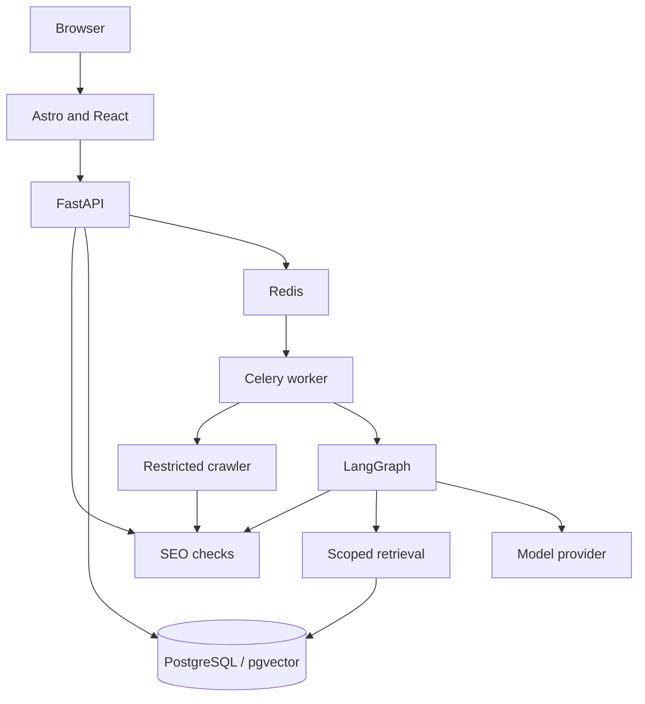

# Architecture

AISEOOnline is designed as a web frontend backed by a modular Python API and separate job workers. This is the intended architecture; none of the application services have been implemented yet.

## Components

| Component | Responsibility |
| --- | --- |
| Web | SEO tool pages, forms, status displays, reports, and project interface |
| API | Input validation, tool endpoints, accounts, access checks, and job submission |
| SEO core | Reproducible checks and evidence-backed findings |
| Crawler | Fetching authorized pages with network and resource limits |
| Workers | Longer site audits, retries, progress tracking, and exports |
| AI services | Bounded model calls, validated outputs, and tool workflows |
| Retrieval | Indexing and searching permitted documents with citations |
| Storage | Accounts, projects, findings, reports, usage records, and embeddings |

## Data flow

A single-page check validates user input and runs the appropriate deterministic tool. When fetching is necessary, a restricted HTTP client collects the required page evidence.

A site audit runs as a background job. The crawler collects pages within an approved scope, SEO rules produce findings, and a workflow may call additional tools to assemble a report.

For question answering, content is indexed with source information. Retrieval applies project authorization before providing context to a model; answers should cite relevant sources and acknowledge missing evidence.

## Infrastructure and trust boundaries

- Public requests must be rate-limited and have small resource budgets.
- Deeper scans and private data require authentication and website ownership checks.
- Crawlers must prevent SSRF at the network boundary, including unsafe redirects and DNS rebinding.
- External page content is untrusted data and must not be treated as agent instructions.
- AI operations require bounded steps, tokens, time, and cost.
- Website-changing actions require appropriate authorization and explicit approval.
- API keys and private data must stay out of public client bundles and traces.

PostgreSQL is the planned system of record. Redis will be used for queues and short-lived caching. Deployment is expected to use containers behind a CDN, with isolated worker networking and monitoring.

For specific technology decisions, see [the ADRs](adr/README.md). Development and review conventions are in [development.md](development.md).
