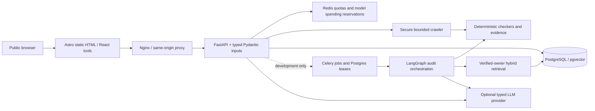
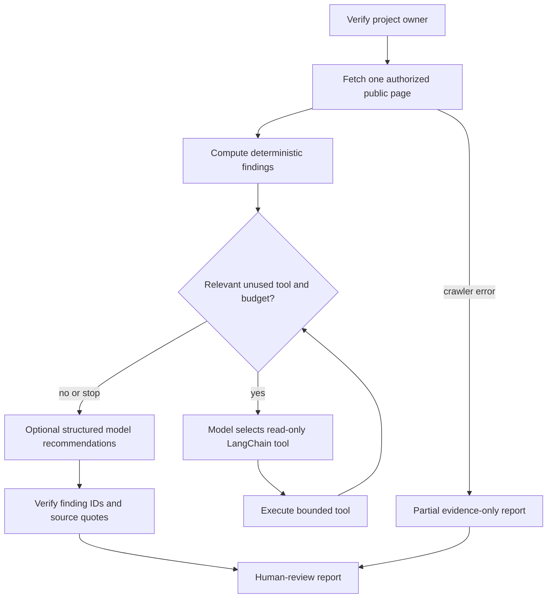

# Architecture and trust boundaries

The repository implements an Astro/React public frontend, FastAPI checks, PostgreSQL
with pgvector, Redis/Celery background work, and development-only LangGraph/RAG
services. This page describes **implemented source**, not a deployed production
service. [Release readiness](release-readiness.md) lists blocking gaps.

Production excludes the private audit and RAG-chat HTTP routers in
`apps/api/src/aiseoonline_api/main.py`. The dotted edge is a
**development/test-only** capability, not a supported public SaaS path.
Do not enable private scans until server-issued identity and worker
entitlement are enforced and infrastructure egress restrictions exist.

## LangGraph state machine

The implementation uses `langgraph.graph.StateGraph` conditional edges and
read-only `langchain_core.tools.StructuredTool` wrappers. Project-scoped RAG
uses PostgreSQL full-text candidates + pgvector cosine similarity joined by
reciprocal rank fusion; rank-fusion fixture scores **do not** represent a
real-world search relevance benchmark. The source-quote guard has a known
semantic-entailment gap. See [LangGraph](langgraph-audit.md),
[retrieval](rag-retrieval.md), and [evaluation](evaluations.md).

## Security and data flow

1. Public tool requests validate one URL and acquire Redis quotas before
   network activity. Secure fetching limits scheme, DNS/IP answers, redirect
   targets, robots.txt, response bytes, elapsed time and concurrent slots.
2. Authenticated account sessions are database-backed and revocable, with
   CSRF and origin checks on mutations; private project reads use owner-scoped
   predicates. Site control uses an HTTPS verification-file challenge.
3. Authorized development job requests persist owner/project IDs, budget
   reservations, leases, checkpoints, trace context and reports in
   PostgreSQL; Celery executes work with bounded retries and sanitized logs.
4. RAG ingestion creates section-aware source chunks with embedding version;
   retrieval applies owner/project verification before merging keyword/vector
   results. Generated answers carry source references and must be reviewed.
5. The optional OTLP/Langfuse exporter emits allowlisted span attributes
   only. Provider prices are configured estimates, not actual reconciled
   invoices. Live collection is disabled until an operator configures it.

**Critical external controls are not supplied by Docker bridges alone:**
production firewall metadata/private-network egress blocks, trusted
Cloudflare visitor attribution, least-privilege runtime DB roles, account
recovery, complete private retention and a verified backup/restore drill.

## Components and evidence

| Implementation | Owned responsibility | Where to inspect |
| --- | --- | --- |
| Web | Ten individual public tool pages, guidance and accessibility | `apps/web/src/pages/tools/`, `apps/web/e2e/` |
| API | Validation, anonymous quotas, owner sessions and errors | `apps/api/src/aiseoonline_api/main.py` and `public_tools/` |
| Crawl/SEO | Validated network fetching and deterministic evidence | `crawler/`, `seo_core/` |
| Agent | Conditional tool orchestration and reports | `agents/workflow.py`, `agents/execution.py` |
| RAG | Scoped ingestion, pgvector/keyword retrieval, citations | `rag/store.py`, `rag/retrieval.py`, `rag/assistant.py` |
| Storage/jobs | Migrations, project identity, queues, checkpoint recovery | `db/models.py`, `apps/api/migrations/`, `apps/worker/` |
| Infra | Non-root containers, release scripts, private origin and smoke CI | `infra/`, `.github/workflows/` |

[Design decisions](adr/README.md) · [Security threat model](security-threat-model.md)
· [Local installation](getting-started.md) · [Operational deployment](deployment.md)
· [Release review](release-readiness.md)
