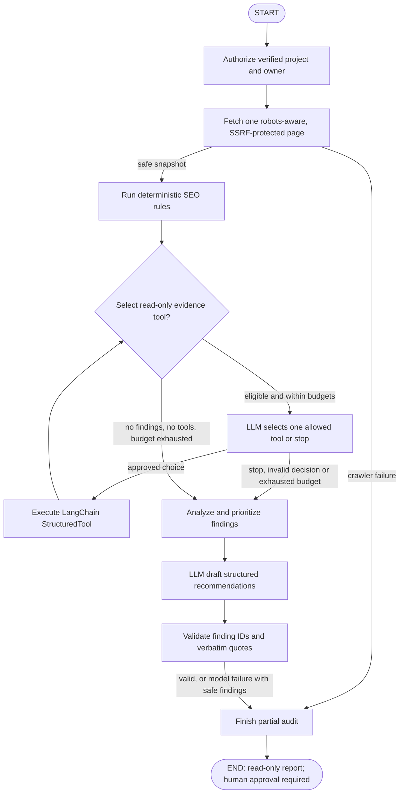

# Verified-owner LangGraph SEO audit

This internal, backend-only workflow turns a *single permitted HTML snapshot* into deterministic SEO findings and optional model-authored, grounded recommendations. It has **no public scan endpoint**, no mutating tools, and no unverified broad crawling. It does not claim to implement an unrestricted autonomous browser operator.

## Flow and decisions



The compiled graph uses `StateGraph`, a typed `AuditState`, explicit node functions, `add_conditional_edges`, and a **real conditional tool loop**, not a fixed sequence of model messages. `AuditAgent.graph.get_graph()` exposes the actual compiled graph.

- **Authorize:** `project_authorizer(session)` checks trusted `owner_id`, project UUID, verified status and hostname in PostgreSQL **before fetching**. This service is not connected to a public route; caller identity must come from server-side authentication, not visitor-provided UUIDs.
- **Collect:** the existing `CrawlSession` securely loads one page, respects robots.txt and DNS/IP/redirect restrictions, enforces existing resource/time limits, and checks origin before analysis. A crawler failure produces a partial report without guessed findings.
- **Checks:** the existing `analyze_page` deterministic rules generate actual source-backed issues for titles, descriptions, headings, canonicals, robots and links. Severity-based priority is assigned in code, not by the model. IDs are derived from each real finding's URL, rule, element, ordinal and observed evidence.
- **Select:** the model receives *only* the names of relevant, unused read-only tools, recorded issue codes and bounded observations. It must return a Pydantic `ToolChoice` naming a currently eligible tool or `stop`. Invalid choices fail closed.
- **Execute:** invokes actual `langchain_core.tools.StructuredTool` wrappers over the fetched snapshot: `headings`, `canonicals`, `structured_data`, `social`, `links`. The `links` tool only classifies visible anchors; it **never probes** further URLs. Optional `rag` uses the existing verified-owner `HybridRetriever` with at most two returned excerpts and a tight source budget. No tool can mutate a website or execute untrusted HTML.
- **Loop:** the agent returns to selection only while relevant unused tools remain and explicit budgets allow another choice. It will not run the same tool twice.
- **Analyze/validate:** the model is asked for a structured `AgentDraft` with at most six recommendations, each naming one real deterministic finding and quoting actual recorded evidence. Code rejects nonexistent/duplicate citations, mismatched quotes and unsupported numerical claims. Model errors and malformed output leave the deterministic evidence intact and mark the report partial.
- **Finish:** returns Pydantic `AuditReport`, including source-backed findings, affected URLs, priorities, optional recommendation text, trace events, limitations and token counts. `requires_human_approval=true`, `action_executed=false` and `website_changes_performed=false` are invariant report fields.

## Budgets and privacy

`AuditRequest` accepts `max_tools` (0–3), `max_model_calls` (1–4), and `max_seconds` (5–60). The compiled graph also has a 14-step recursion limit and uses the existing LLM provider's per-call token, HTTP retry and concurrency policies. In the normal maximum case there are three decisions plus one final response. **There is no anonymous paid-call budget here because no public endpoint is exposed.** Production deployment requires a separately approved authenticated job queue, Redis-backed spending allocation and cost monitoring before exposing any such workflow.

`use_private_rag` defaults to false. Only the operator can explicitly enable it; it reuses the existing project-owned vector retrieval. The agent does not persist conversation content or index website text by itself. Trace objects record node names, outcomes and chosen tools only; no raw page text, credentials, or model errors. Never log raw graph state or the untrusted model payload in production.

Website page text and RAG snippets are untrusted *user-role data* in a versioned prompt; they never become system instructions. This separation reduces—but cannot eliminate—prompt injection risk. HTML scripts and JSON-LD remain inert. Structured validation cannot establish the full truth of a generated recommendation; humans must review all proposed wording before action.

### Backend usage (not a public API)

```python
from uuid import UUID
from sqlalchemy.orm import Session
from aiseoonline_api.agents import AuditAgent, AuditRequest, project_authorizer
from aiseoonline_api.ai_core import make_openai_provider
from aiseoonline_api.config import Settings
from aiseoonline_api.db.session import create_database_engine

settings = Settings()
engine = create_database_engine(settings)
provider = make_openai_provider(settings)

async def run_audit():
    with Session(engine) as session:
        audit = AuditAgent(authorize=project_authorizer(session), llm=provider)
        return await audit.run(
            AuditRequest(
                owner_id=UUID("REPLACE_WITH_AUTHENTICATED_OWNER_UUID"),
                project_id=UUID("REPLACE_WITH_VERIFIED_PROJECT_UUID"),
                url="https://example.org/seo",
            )
        )
```

The snippet intentionally does not invoke paid OpenAI calls automatically. Wrap calls in an application-managed authorized job, handle provider cleanup, and set its total cost reservation before scheduling.

## Verification

Offline tests use controlled snapshot fixtures and scripted Pydantic provider responses. The PostgreSQL integration test creates two different users and a verified project, indexes a controlled HTML excerpt, invokes an actual LangChain RAG tool against `HybridRetriever`, checks graph transitions, and proves another user is denied before any crawl.

```sh
uv sync --project apps/api --locked --group dev
uv run --project apps/api --locked pytest apps/api/tests/test_audit_agent.py -q -s
AISEO_TEST_DATABASE_URL=postgresql+psycopg://... \
  uv run --project apps/api --locked pytest apps/api/tests/test_audit_agent_integration.py -q -s
```

The integration test prints a **sanitized actual trace** with graph node names and outcomes. No real external site or paid LLM calls are made during CI.

### Known limitations

This workflow only analyzes one static HTML response at a time. Page-wide JavaScript rendering, sitewide audits, broken-link verification and edits are out of scope. SEO severity and recommended corrections remain advisory, not search-ranking guarantees. Trusted ownership verification must remain mandatory for all callers. The model can refuse or produce invalid output; in those cases the deterministic findings remain available, without fabricated AI conclusions. Live model interoperability and real paid budgets have not been verified.
